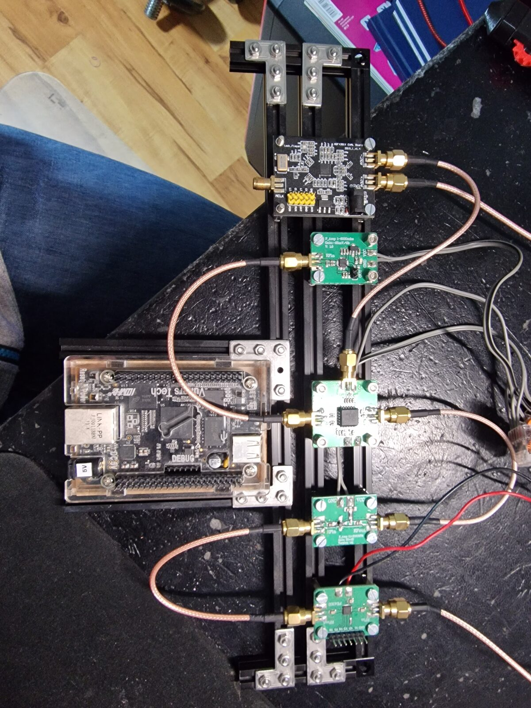

# As-built check (photos, 2026-11-01)

Photos (resized copies, originals are in the Claude project): [PE4302](photos/pe4302-module.jpg), [AD831](photos/ad831-module.jpg), [detector](photos/detector-module.jpg), [ADF4351](photos/adf4351-board.jpg), [whole setup](photos/setup-overview.jpg).

## RF chain as built (traced in the overview photo)

RF input cable -> PE4302 `RFin`; PE4302 `RFout` -> amp `RFin`; amp `RFout` -> AD831 `RFin`; ADF4351 output -> AD831 `LOin`; AD831 `IFout` -> detector `RFin`. Everything is direct SMA to SMA with short RG316-style pigtails, on black aluminium extrusion rails with L-brackets. There is no low-pass filter, DC block, pad, IF filter or IF amplifier yet. That matches the plan (`todo-parts.md`). The BeagleBone Black sits in a clear case at the left with nothing connected to its headers yet.

## Cross-check of the assumptions

| Assumption in the docs | What the photos and the module description show | Result |
|---|---|---|
| PE4302 module has parallel control only | 7-pin header `GND V1 ... V6`; serial pins hard-wired off | confirmed |
| V1 to V6 = 0.5, 1, 2, 4, 8, 16 dB, high = stage in | matches the published description of this module (Silicon Chip, El Cheapo Modules 17) | confirmed from the description; still confirm with `pe4302-walk` |
| 10 kohm **pull-ups** on V1 to V6 for a safe default | the module has 10 kohm **pull-downs**: open inputs = 0 dB | **corrected**, see `boards/pe4302.md` |
| PE4302 supply on the header | supply is on two separate pads with red and black leads; header has no VDD | **corrected** |
| PE4302 supply 3.3 V | the module has no regulator and is meant for 3.3 V; the rail voltage on the leads is not known | open |
| PE4302 RF ports DC-blocked | series parts visible in both RF traces | probably, verify with a DMM |
| ADF4351 board is a bare 3.3 V board needing its own clean 3.3 V | has a 5 V DC jack and an AMS1117-3.3 regulator | **corrected**: power it from 5 V |
| Reference 25 MHz (VERIFY in config) | oscillator `V25.000` on the board | confirmed |
| One lock-detect pin `LD / MUXOUT` | separate `LD` and `MUX` header pins | **corrected**: use `LD` |
| CE can be tied high | header has `CE` and also `PDR` (RF power-down, must be high) | **added** `PDR` |
| ADF4351 has one RF output | two complementary SMA outputs `AOUT-` / `AOUT+` plus `MCLK` input | noted: terminate the unused one |
| AD831 is a bare chip or the common module | module `AD831_MIX Freq:1-500MHz`, SMA `RFin`, `LOin`, `IFout`, pads `GND` and `VCC` | confirmed: single-supply module |
| Detector is an AD8318-class module | `P_Amp 1-8000mhz`, `Gain: -25mV/dB`, `V: 1.0`; pads `VCC` `GND`, 2-pin `OUT` header, on-board regulator and LED | confirmed; regulator input range unknown |
| 30 dB amp module | seen only in the overview (`GND VCC`, `RFin RFout`, `Version 1.1`) | consistent |
| Chain order PE4302, amp, mixer, detector | as traced above | confirmed |

## What I could not tell from the photos

1. **Voltage on the shared supply.** Grey twin leads from the detector, mixer and amp end at an orange lever connector at the right edge, and the PE4302 has its own red and black leads. If one rail feeds all of them, it cannot suit everything: the PE4302 wants 3.3 V, the AD831 module wants 9 to 11 V (datasheet single supply), the amp takes 6 to 12 V, and the detector depends on its regulator. Please measure the rail(s) before the SBC is connected.
2. Detector regulator marking (SOT-223 next to the `VCC` pad) and which pin of the `OUT` header is GND.
3. Which ADF4351 output goes to the mixer and what the other output sees.
4. Polarity marking next to the ADF4351 DC jack.
5. Whether the ADF4351 board already pulls `CE` and `PDR` high.
