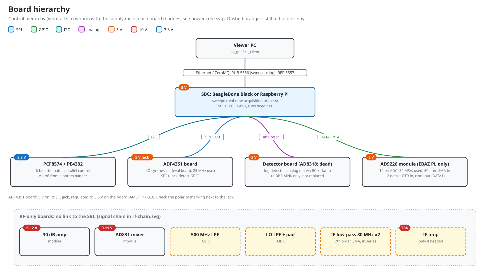
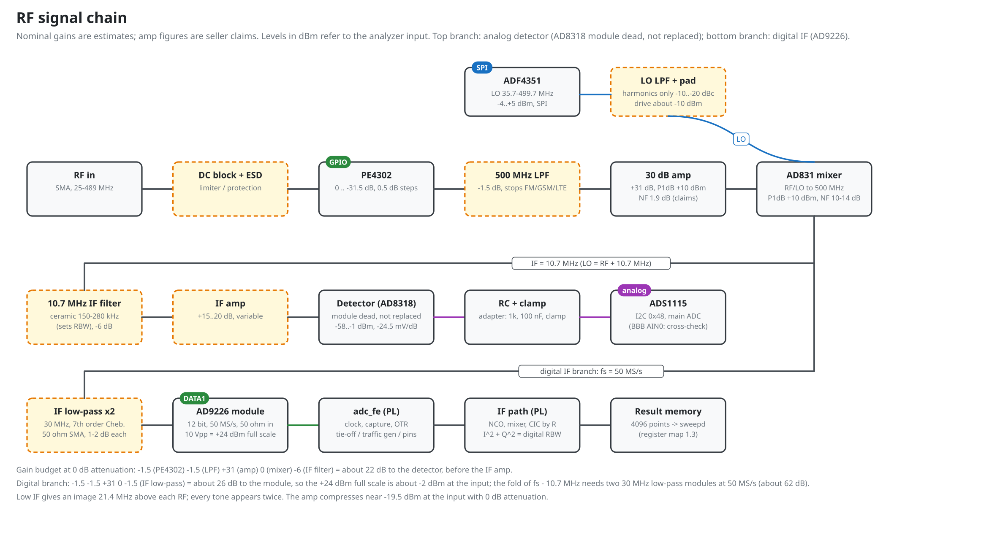
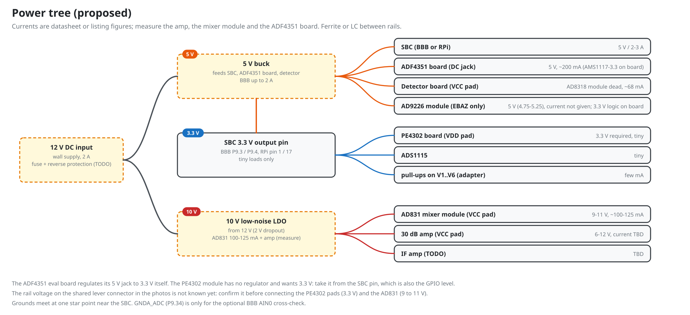

# Board hierarchy, signal chain and power

Generated diagrams (source: `tools/gen_diagrams.py`). Dashed orange boxes are parts still to build or buy.

## Control hierarchy



| Parent | Child | Interface | Direction | Rail of the child |
|---|---|---|---|---|
| Viewer PC | SBC | Ethernet, ZeroMQ: PUB 5556, REP 5557 | both | n/a |
| SBC | PCF8574 board | I2C (SCL, SDA), address 0x27 | both | 3.3 V (not 5 V) |
| PCF8574 board | PE4302 board | V1..V6 from P0..P2 and P4..P6, 2.2 kohm pull-ups (parallel control, the module has no serial interface) | expander to board | 3.3 V |
| SBC | ADF4351 board | SPI (CLK, DAT, LE) + LD GPIO | SBC to board, LD back | 5 V on the DC jack (3.3 V regulated on the board) |
| Detector board (AD8318) | SBC | analog voltage through the adapter's divider to the BBB AIN0 (the ADS1115 was removed). **The module is dead and not replaced** (user decision 2026-11-23: no log detector is bought) | board to SBC | 5 V |
| AD9226 module (EBAZ4205 only) | PL sweep engine | 12 data lines + OTR in, sample clock out: 14 signals on DATA1 (adapter v2; the pins are not built into the default bitstream, see `../zynq-ebaz/docs/adc-module.md`) | module to PL, clock to module | 5 V (3.3 V logic made on the module) |
| (no link) | 30 dB amp, AD831 mixer, 500 MHz LPF, LO LPF + pad, 2 x 30 MHz IF low-pass, IF amp (only if needed) | RF only | n/a | 10 V for amp, mixer and IF amp (check each) |

## RF signal chain



The diagram has two ends after the mixer. The analog branch (IF filter, IF amp, log detector, ADC) is the original plan; its detector module is dead and no replacement is bought. The digital IF branch is the way forward on the EBAZ4205: two 30 MHz low-pass modules in series (the only filter option on offer, 7th order Chebyshev, SMA, in series about 62 dB at the alias band at 50 MS/s), then the AD9226 module (12 bit, up to 65 MS/s, sampled at 50 MS/s), then the PL: `adc_fe`, the IF path (digital down-conversion at 10.7 MHz, CIC filter sets the RBW) and the result memory. Details, level plan and open points: [../zynq-ebaz/docs/adc-module.md](../zynq-ebaz/docs/adc-module.md). The BBB has no PL: it cannot use the digital branch.

Frequency plan: IF = 10.7 MHz, LO = RF + 10.7 MHz, RF about 25 to 489 MHz by hardware (ADF4351 minimum, AD831 LO maximum); the software default is 30 to 480 MHz (`config/default.toml`). The gain figures are estimates and the amp numbers are seller claims; replace them with measurements (`docs/bringup.md`).

## Power tree



- One 12 V input. 5 V buck for the SBC, the ADF4351 board (its DC jack, regulated on the board), the AD9226 module (EBAZ4205 only) and, if it is ever repaired or replaced, the detector; 10 V low-noise LDO for the AD831 module, the amp and the IF amp. The PE4302 and the PCF8574 board take 3.3 V from the SBC's 3V3 pin (P9.3), small loads only.
- Ferrite or LC filter between rails; ground at one star point near the SBC.
- Currents on the diagram are datasheet or listing figures. Measure the amp, the ADF4351 board and the AD9226 module (the listing gives no current).

## Files

| File | Content |
|---|---|
| `wiring-bbb.md`, `wiring-rpi.md` | pin tables, wiring order, checks for each SBC (EBAZ4205: `../zynq-ebaz/docs/pinmap.md`, `diagrams/ebaz-*.svg`) |
| `netlist.md` | generated net list and straps |
| `wiring.md` | RF cabling between boards |
| `boards/*.md` | per-board connector and test-point notes (fill in from the PCBs) |
| `diagrams/*.svg`, `*.png` | generated; do not edit |

## Regenerate

```
python tools/gen_diagrams.py            # SVG + PNG (needs rsvg-convert, cairosvg or PyQt5 for PNG) and netlist.md
python tools/gen_diagrams.py --no-png
```

Edit the pin map in `src/sadiy/pinmap.py`, or `STRAPS` and the diagram functions in `tools/gen_diagrams.py`, then regenerate.
