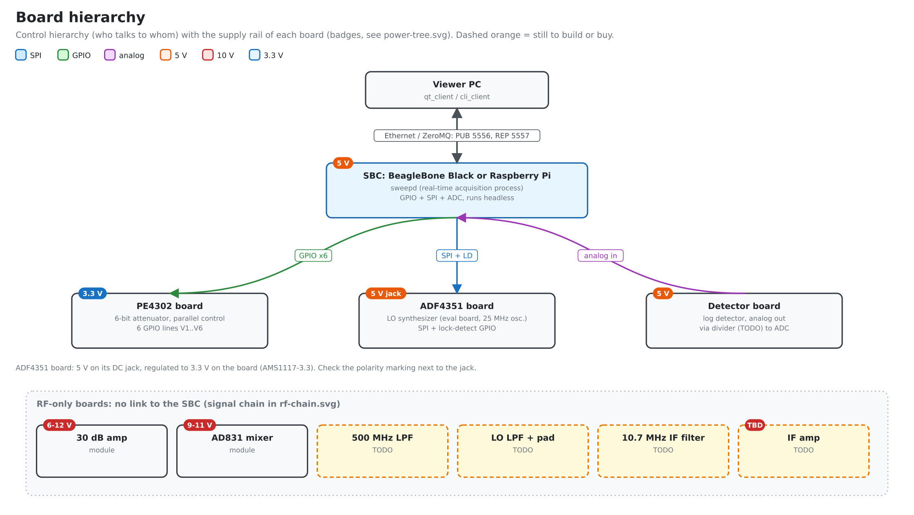
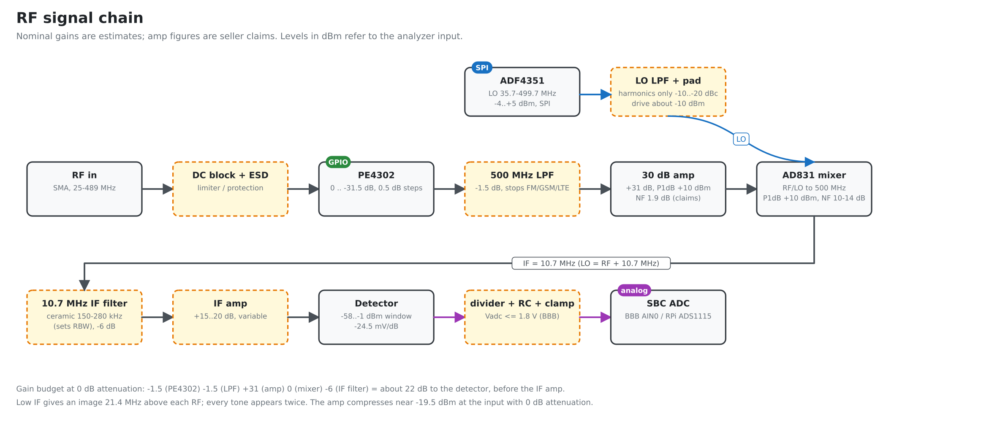
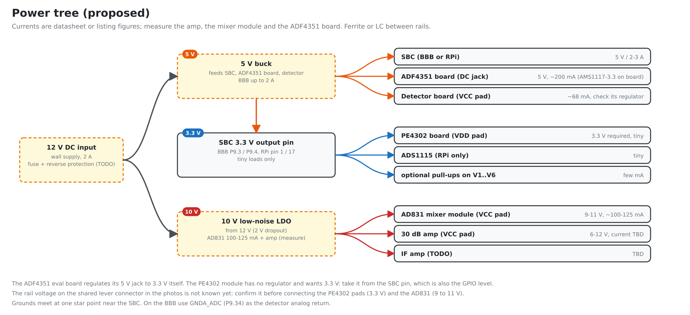

# Board hierarchy, signal chain and power

Generated diagrams (source: `tools/gen_diagrams.py`). Dashed orange boxes are parts still to build or buy.

## Control hierarchy



| Parent | Child | Interface | Direction | Rail of the child |
|---|---|---|---|---|
| Viewer PC | SBC | Ethernet, ZeroMQ: PUB 5556, REP 5557 | both | n/a |
| SBC | PE4302 board | 6 GPIO lines V1..V6 on P8 / RPi header (parallel control, the module has no serial interface) | SBC to board | 3.3 V |
| SBC | ADF4351 board | SPI (CLK, DAT, LE) + LD GPIO | SBC to board, LD back | 5 V on the DC jack (3.3 V regulated on the board) |
| Detector board | SBC | analog voltage through divider/RC/clamp to the ADC | board to SBC | 5 V |
| (no link) | 30 dB amp, AD831 mixer, 500 MHz LPF, LO LPF + pad, 10.7 MHz IF filter, IF amp | RF only | n/a | 10 V for amp, mixer and IF amp (check each) |

## RF signal chain



Frequency plan: IF = 10.7 MHz, LO = RF + 10.7 MHz, RF about 25 to 489 MHz. The gain figures are estimates and the amp numbers are seller claims; replace them with measurements (`docs/bringup.md`).

## Power tree



- One 12 V input. 5 V buck for the SBC and detector, 3.3 V low-noise LDO from the 5 V rail for the synthesizer, PE4302 and ADS1115, 10 V low-noise LDO for the AD831 module, the amp and the IF amp.
- Ferrite or LC filter between rails; ground at one star point near the SBC.
- Currents on the diagram are datasheet or listing figures. Measure the amp and the ADF4351 board.

## Files

| File | Content |
|---|---|
| `wiring-bbb.md`, `wiring-rpi.md` | pin tables, wiring order, checks for each SBC |
| `netlist.md` | generated net list and straps |
| `wiring.md` | RF cabling between boards |
| `boards/*.md` | per-board connector and test-point notes (fill in from the PCBs) |
| `diagrams/*.svg`, `*.png` | generated; do not edit |

## Regenerate

```
python tools/gen_diagrams.py            # SVG + PNG (needs rsvg-convert or cairosvg for PNG) and netlist.md
python tools/gen_diagrams.py --no-png
```

Edit the pin map (`NETS`, `STRAPS`) and the diagram functions in that script, then regenerate.
