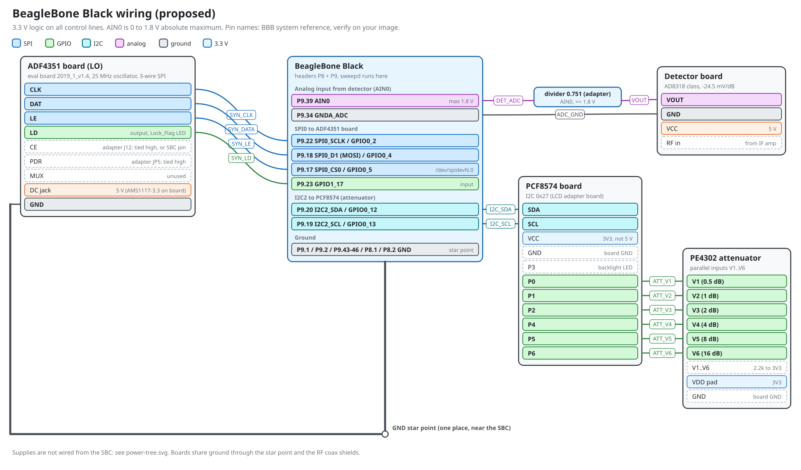
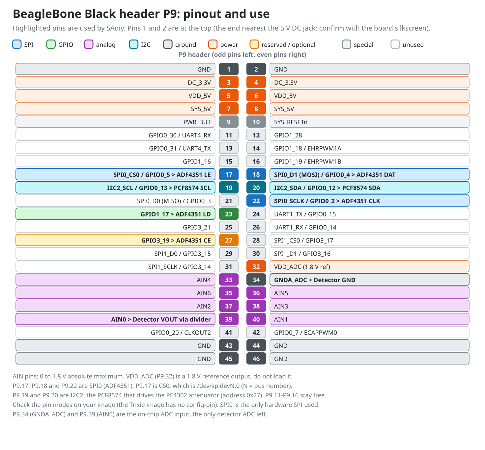
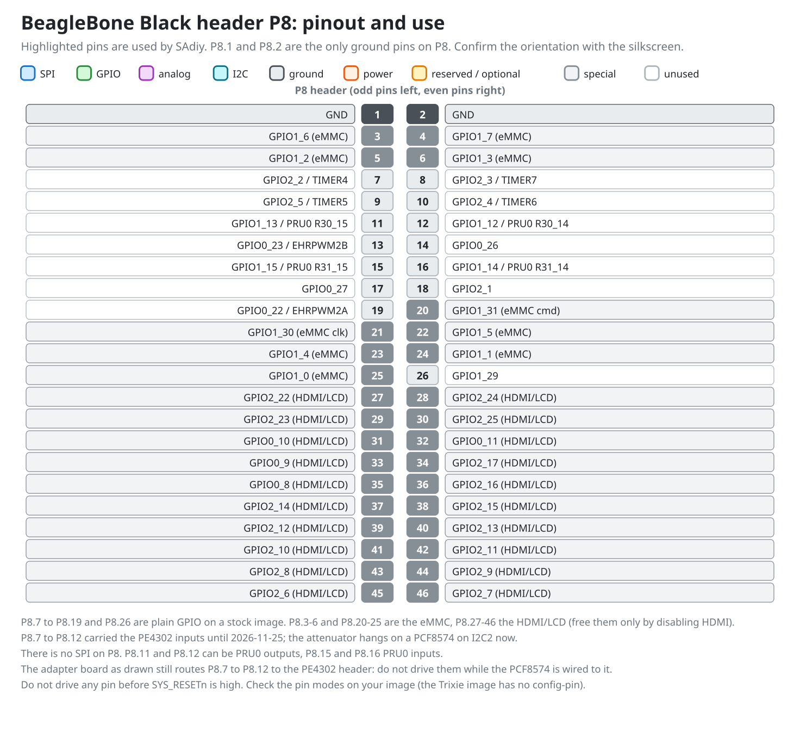

# Wiring: BeagleBone Black

Diagrams: [wiring](diagrams/bbb-wiring.png) ([svg](diagrams/bbb-wiring.svg)), [P9 pinout](diagrams/bbb-p9-pinout.png) ([svg](diagrams/bbb-p9-pinout.svg)) and [P8 pinout](diagrams/bbb-p8-pinout.png) ([svg](diagrams/bbb-p8-pinout.svg)). Full net list: [netlist.md](netlist.md).







The pin map is a proposal. Pin and mux names come from the BBB system reference, so confirm each one on your image before wiring. On older images that is `config-pin -l P9_xx` and `show-pins`; the Debian Trixie image (kernel 6.18) has no `config-pin`, so read the pin modes from `/sys/kernel/debug/pinctrl` (see `deploy/bbb-setup.md`) and from the GUI's Pins tab.

## Pins used

| Net | Board pin | BBB pin | GPIO number | Notes |
|---|---|---|---|---|
| SYN_CLK | ADF4351 CLK | P9.22 SPI0_SCLK | n/a | SPI mode 0, MSB first |
| SYN_DATA | ADF4351 DAT | P9.18 SPI0_D1 (MOSI) | n/a | 32-bit words |
| SYN_LE | ADF4351 LE | P9.17 SPI0_CS0 | n/a | hardware chip select |
| SYN_LD | ADF4351 LD | P9.23 GPIO1_17 | 49 | input (Lock_Flag), the MUX pin stays unused |
| SYN_CE (optional) | ADF4351 CE | P9.27 GPIO3_19 | 115 | tie the CE header pin to the board's 3V3 pin until needed; software control: `python tools/bringup.py synth-ce on\|off\|release\|read` (J12 2-3 to use it) |
| I2C_SCL | PCF8574 SCL | P9.19 I2C2_SCL | n/a | attenuator port expander, address 0x27 (adapter board: J10 pin 3). I2C2 already has pull-ups; 100 kHz maximum |
| I2C_SDA | PCF8574 SDA | P9.20 I2C2_SDA | n/a | attenuator port expander (adapter board: J10 pin 4) |
| DET_ADC | Detector VOUT via divider | P9.39 AIN0 | n/a | cross-check only. **0 to 1.8 V absolute maximum** |
| ADC_GND | Detector GND | P9.34 GNDA_ADC | n/a | optional, AIN0 cross-check only |
| GND | all boards | P9.1, P9.2, P9.43-46, P8.1, P8.2 | n/a | one star point; P8.1 / P8.2 are the nearest ground pins for the PE4302 ribbon |

GPIO number = bank x 32 + bit (GPIO1_28 = 60, GPIO2_5 = 69). This is not always the number sysfs uses: on kernel 6.18 the bases are 608, 512, 544, 576 for banks 0 to 3, so P9.27 (GPIO3_19) is 595. `hal/linux.py` translates, and `python tools/bringup.py gpio-map` prints the result on the board. The code takes the numbers in this table (`src/sadiy/pinmap.py`). P8.7 to P8.19 and P8.26 are free GPIO on a stock image; P8.3-6 and P8.20-25 are the eMMC and P8.27-46 the HDMI/LCD, so avoid them. **P8.7 to P8.12 were the six attenuator lines until 2026-11-25:** the adapter board still connects them (through 220 ohm) to its PE4302 header, so leave them as inputs.

## Attenuator control (PE4302 module behind a PCF8574)

The module has no serial interface: a 7-pin header `GND V1 V2 V3 V4 V5 V6` (photo: `photos/pe4302-module.jpg`), six logic inputs, each switching one attenuator stage. The published description of this module gives V1 to V6 = 0.5, 1, 2, 4, 8, 16 dB with high = stage switched in; confirm it with the walk tool. The VDD comes in on two separate pads next to the chip, not on the header. A PCF8574 port expander on I2C2 drives the six inputs (full notes: [boards/pe4302.md](boards/pe4302.md)):

| PCF8574 | goes to |
|---|---|
| VCC, GND | 3.3 V and ground. **Not 5 V**: the board's I2C pull-ups go to its VCC |
| SCL, SDA | P9.19, P9.20 |
| P0, P1, P2 | PE4302 V1, V2, V3 |
| P4, P5, P6 | PE4302 V4, V5, V6 |
| P3 | the backlight LED of the LCD adapter board (`attenuator.pcf8574_backlight`) |

**On the adapter board as built** (no copper changes): J10, the former ADS1115 header, has 3V3 on pin 1, GND on pin 2, SCL on pin 3 and SDA on pin 4 (the PCF8574 board's header usually has another order: wire by name). Wire P0..P2 and P4..P6 to the V1..V6 nets (test points TP_PE_V1..V6); the PE4302 stays on J4, and R27..R32 are the pull-ups the expander needs.

How the driver behaves (`src/sadiy/drivers/pe4302.py`, `drivers/pcf8574.py`):
- At start all six stages are switched in (31.5 dB), the safe state; the PCF8574 also powers up with all ports high.
- All six lines change with one I2C byte. A change that switches stages both in and out is two bytes in one transaction, the new stages in first: from 15.5 dB to 16 dB it passes through 31.5 dB, never through 0 dB. All 64 x 64 transitions are tested for this.
- Preview any change: `python tools/bringup.py pe4302-pattern --db 16 --from-db 15.5` prints the line levels, the write order and the attenuation after each write.

Pull-ups:
- **Required.** The PCF8574 drives high only with about 100 uA, and the module has 10 kohm pull-downs on V1 to V6: without pull-ups a "high" is about 1 V. With 2.2 kohm to 3.3 V it is about 2.7 V, above the 2.3 V threshold, and the expander sinks about 1.5 mA per low line. The adapter board has them (R27..R32); wired directly, add them. Open inputs (no pull-ups, nothing driving) mean 0 dB.
- **Supply:** the module has no regulator and is meant for 3.3 V. Take VDD from the SBC 3.3 V pin (P9.3). Measure the voltage on the supply pads before connecting anything: the leads go toward the shared lever connector in the photos.

**Identify V1 to V6 with the walk tool** (run it on the BBB, `sweepd` stopped):

```
sudo env PYTHONPATH=src python3 tools/bringup.py pe4302-walk
```

It switches one stage in at a time. Check each line with a DMM at the PE4302 header, and the weight with a low-level tone through the attenuator on the scope (its text describes the log detector, which is dead: with a working one the output would RISE by weight x 24.5 mV). Keep the RF level below -20 dBm. Write the measured weights into `attenuator.weights_db` and set `attenuator.active_high`. `--dry-run` prints the procedure without touching I2C.

## Before you connect anything

1. Verify the pin mux. On an image with `config-pin` (not Trixie), `config-pin -l P9_17` (and the others) lists the modes it supports. Typical names are `spi_cs`, `spi`, `spi_sclk` for the SPI0 pins and `gpio` for the GPIO pins. P9.11 and P9.13 default to GPIO but belong to UART4, P9.14 and P9.16 to EHRPWM1.
2. Enable SPI0 with the spidev overlay for your image. The device node depends on the image: check `ls /dev/spidev*` (commonly `/dev/spidev1.0` for SPI0).
3. Check the ADC node: `cat /sys/bus/iio/devices/iio:device0/in_voltage0_raw` with AIN0 open.
4. Decide the supply path (`power-tree.svg`). The ADF4351 board takes 5 V on its DC jack (check the polarity marking) and regulates to 3.3 V itself: do not feed its `3V3` header pin. The PE4302 VDD pad and the PCF8574 board can take 3.3 V from P9.3.

## Wiring order

1. Power the SBC alone. Check the 3.3 V and 5 V rails on the header with a DMM.
2. Connect **ground first**: BBB GND (P9.1) to the star point, then each board's GND to the star point.
3. PE4302 board and PCF8574: measure the voltage on the PE4302's supply pads first, then VDD pad to P9.3 (3.3 V) and `GND` to the star point (P8.2 is the nearest ground pin). PCF8574 board: VCC to 3.3 V, GND, SCL to P9.19, SDA to P9.20, and P0..P2, P4..P6 to V1..V6 with 2.2 kohm pull-ups to 3.3 V (on the adapter board: see above). `i2cdetect -y -r 2` must show it. Run the walk tool and note the weights and polarity before connecting any RF.
4. ADF4351 board: 5 V on the DC jack, `CE` and `PDR` high (on the adapter board: jumper J12 1-2 for CE, JP5 for PDR; wired directly, to the board's `3V3` pin unless the board already pulls them up), then `CLK`, `DAT`, `LE` (P9.22, P9.18, P9.17), `LD` (P9.23) and `GND`. Capture the SPI lines with the DSLogic (`python tools/bringup.py adf4351-pattern --word 0x...`). Do not connect the RF output to anything sensitive yet.
5. Detector: VCC 5 V, GND. Connect VOUT to the divider, check the divider output with a DMM **before** connecting it to P9.39 (only if you use the AIN0 cross-check).
6. P9.39 (AIN0) and P9.34 (GNDA_ADC) are the BBB's only detector ADC.

## Analog input (AIN0)

The BBB's only detector ADC since the ADS1115 was removed (2026-11-25). The adapter has the path (JP6). The bench mode reads it (compare with a DMM), and `adc.kind = "bbb_iio"` selects it. Its ratio is `adc.ain0_divider_ratio`. The adapter's J8 path to the former ADS1115 (1k, 100 nF, clamp, to J10 pin 7) is unused.

- The AM335x ADC is 12 bit with a 1.8 V full scale, so one LSB is about 0.44 mV.
- The detector output is about 0.5 V at -1 dBm and about 1.9 V near -58 dBm (datasheet points, about -24.5 mV/dB), and can go higher with no signal. A divider is required.
- Example: ratio Vadc / Vdet = 0.75 keeps 1.9 V below 1.45 V; one LSB then equals about 0.6 mV at the detector, about 0.024 dB. Put the real ratio in `config/default.toml` as `adc.ain0_divider_ratio`.
- Add an RC low-pass at the pin and a clamp (for example a low-leakage Schottky diode from the node to VDD_ADC, P9.32) so a fault cannot exceed 1.8 V. Keep the source impedance low, or buffer with an op-amp (check the AM335x datasheet for the allowed source impedance).
- Do not use P9.32 (VDD_ADC) to supply anything.
- Route the detector return to P9.34, not to a digital GND pin, and keep the wire short.

## Power-on checks (DMM)

| Check | Expect |
|---|---|
| 3.3 V at the PE4302 VDD pad (from P9.3), the PCF8574's VCC and the ADF4351 board `3V3` pin | 3.0 to 3.6 V |
| 10 V rail at the AD831 module | 9 to 11 V |
| 5 V at the detector | 4.75 to 5.5 V |
| V1 to V6 with the PCF8574 just powered | high, above 2.3 V (pull-ups) = 31.5 dB; about 1 V or low means missing pull-ups |
| P9.39 with the detector powered and no RF | below 1.8 V at every point of the divider |

Then follow `docs/bringup.md`.
