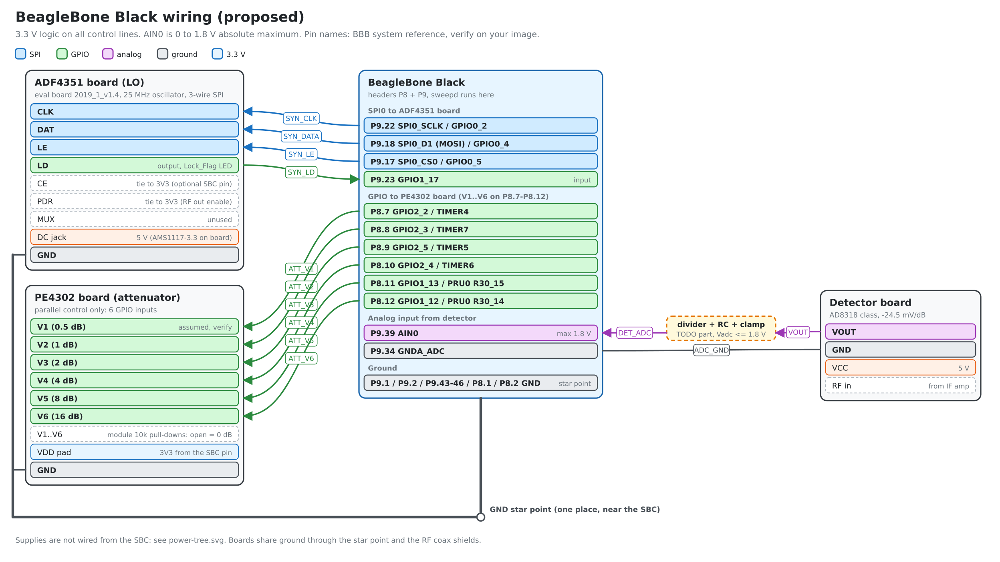
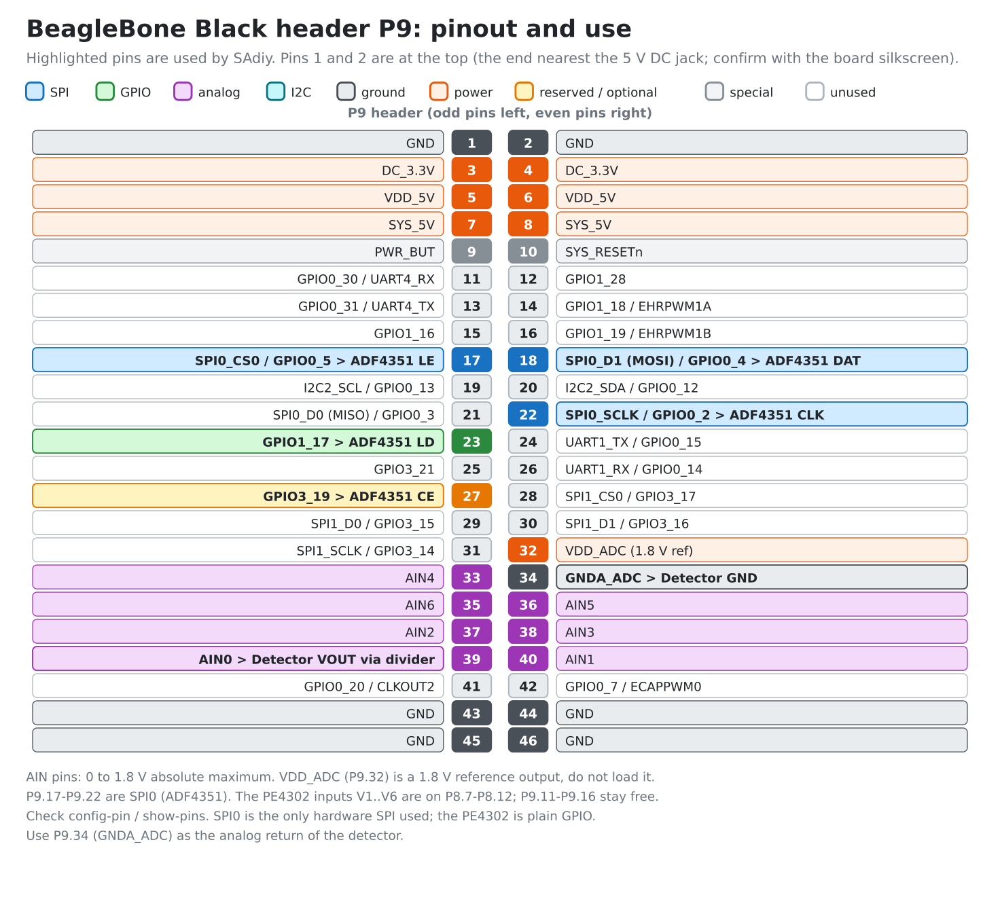
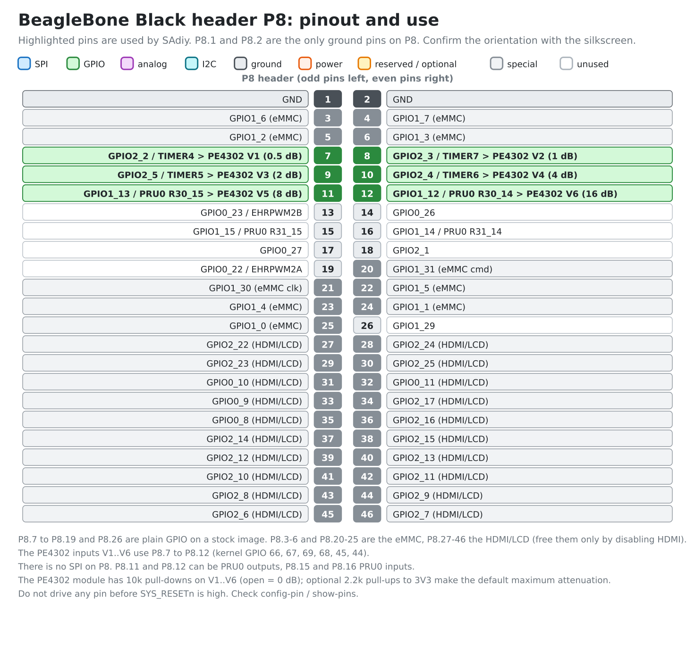

# Wiring: BeagleBone Black

Diagrams: [wiring](diagrams/bbb-wiring.png) ([svg](diagrams/bbb-wiring.svg)), [P9 pinout](diagrams/bbb-p9-pinout.png) ([svg](diagrams/bbb-p9-pinout.svg)) and [P8 pinout](diagrams/bbb-p8-pinout.png) ([svg](diagrams/bbb-p8-pinout.svg)). Full net list: [netlist.md](netlist.md).







The pin map is a proposal. Pin and mux names come from the BBB system reference, so confirm each one on your image with `config-pin -l P9_xx` and `show-pins` before wiring.

## Pins used

| Net | Board pin | BBB pin | Kernel GPIO | Notes |
|---|---|---|---|---|
| SYN_CLK | ADF4351 CLK | P9.22 SPI0_SCLK | n/a | SPI mode 0, MSB first |
| SYN_DATA | ADF4351 DAT | P9.18 SPI0_D1 (MOSI) | n/a | 32-bit words |
| SYN_LE | ADF4351 LE | P9.17 SPI0_CS0 | n/a | hardware chip select |
| SYN_LD | ADF4351 LD | P9.23 GPIO1_17 | 49 | input (Lock_Flag), the MUX pin stays unused |
| SYN_CE (optional) | ADF4351 CE | P9.27 GPIO3_19 | 115 | tie the CE header pin to the board's 3V3 pin until needed |
| ATT_V1 | PE4302 V1 (0.5 dB, assumed) | P8.7 GPIO2_2 | 66 | TIMER4 pin, default mode is GPIO |
| ATT_V2 | PE4302 V2 (1 dB) | P8.8 GPIO2_3 | 67 | TIMER7 pin |
| ATT_V3 | PE4302 V3 (2 dB) | P8.9 GPIO2_5 | 69 | TIMER5 pin |
| ATT_V4 | PE4302 V4 (4 dB) | P8.10 GPIO2_4 | 68 | TIMER6 pin |
| ATT_V5 | PE4302 V5 (8 dB) | P8.11 GPIO1_13 | 45 | PRU0 R30_15 alternate |
| ATT_V6 | PE4302 V6 (16 dB) | P8.12 GPIO1_12 | 44 | PRU0 R30_14 alternate |
| DET_ADC | Detector VOUT via divider | P9.39 AIN0 | n/a | **0 to 1.8 V absolute maximum** |
| ADC_GND | Detector GND | P9.34 GNDA_ADC | n/a | analog return |
| GND | all boards | P9.1, P9.2, P9.43-46, P8.1, P8.2 | n/a | one star point; P8.1 / P8.2 are the nearest ground pins for the PE4302 ribbon |

Kernel GPIO number = bank x 32 + bit (GPIO1_28 = 60, GPIO2_5 = 69). The sysfs backend (`hal/linux.py`) takes these numbers; they are also in `config/default.toml` (`attenuator.gpio_bbb`). The PE4302 sits on P8 because it is plain GPIO and needs no SPI; SPI0 on P9 stays dedicated to the ADF4351. P8.7 to P8.19 and P8.26 are free GPIO on a stock image; P8.3-6 and P8.20-25 are the eMMC and P8.27-46 the HDMI/LCD, so avoid them.

## Attenuator control (PE4302 module, parallel only)

The module has no serial interface: a 7-pin header `GND V1 V2 V3 V4 V5 V6` (photo: `photos/pe4302-module.jpg`), six logic inputs, each switching one attenuator stage. The published description of this module gives V1 to V6 = 0.5, 1, 2, 4, 8, 16 dB with high = stage switched in; confirm it with the walk tool. The VDD comes in on two separate pads next to the chip, not on the header.

How the driver behaves (`src/sadiy/drivers/pe4302.py`):
- At start all six lines are driven to "stage in" (31.5 dB), the safe state.
- The six writes are not simultaneous, so stages that turn on are written before stages that turn off. A change from 15.5 dB to 16 dB passes through 31.5 dB, never through 0 dB. All 64 x 64 transitions are tested for this.
- Preview any change: `python tools/bringup.py pe4302-pattern --db 16 --from-db 15.5` prints the line levels, the write order and the attenuation after each write.

Hardware you should add:
- **The module has 10 kohm pull-downs on V1 to V6**, so open inputs mean 0 dB attenuation: while the BBB is off or booting the full signal passes. If that matters, add 2.2 kohm pull-ups to 3.3 V on the six lines: with the module's 10 kohm pull-down that gives about 2.7 V at the input, above the 2.3 V threshold, so the default becomes 31.5 dB (each SBC pin then sinks about 1.5 mA when driving low).
- **Supply:** the module has no regulator and is meant for 3.3 V. Take VDD from the SBC 3.3 V pin (P9.3), which is also the GPIO level. A high input needs 0.7 x VDD, so with a 5 V supply the 3.3 V GPIO would not reach it. Measure the voltage on the supply pads before connecting anything: the leads go toward the shared lever connector in the photos.

**Identify V1 to V6 with the walk tool** (run it on the BBB with a low-level tone through the attenuator into the detector and a DMM on the detector output):

```
python tools/bringup.py pe4302-walk --gpio 66,67,69,68,45,44
```

It switches one stage in at a time. The detector output should RISE by weight x 24.5 mV (V6 about 392 mV, V1 about 12 mV). Keep the RF level below -20 dBm. Write the measured weights into `attenuator.weights_db` and set `attenuator.active_high`. `--dry-run` prints the procedure without touching GPIO.

## Before you connect anything

1. Verify the pin mux: `config-pin -l P9_17` and `config-pin -l P8_07` (and the others) list the modes your image supports. P8.7 to P8.12 should default to `gpio`. Typical names are `spi_cs`, `spi`, `spi_sclk` for the SPI0 pins and `gpio` for the GPIO pins. P9.11 and P9.13 default to GPIO but belong to UART4, P9.14 and P9.16 to EHRPWM1.
2. Enable SPI0 with the spidev overlay for your image. The device node depends on the image: check `ls /dev/spidev*` (commonly `/dev/spidev1.0` for SPI0).
3. Check the ADC node: `cat /sys/bus/iio/devices/iio:device0/in_voltage0_raw` with AIN0 open.
4. Decide the supply path (`power-tree.svg`). The ADF4351 board takes 5 V on its DC jack (check the polarity marking) and regulates to 3.3 V itself: do not feed its `3V3` header pin. The PE4302 VDD pad can come from P9.3.

## Wiring order

1. Power the SBC alone. Check the 3.3 V and 5 V rails on the header with a DMM.
2. Connect **ground first**: BBB GND (P9.1) to the star point, then each board's GND to the star point.
3. PE4302 board: measure the voltage on its supply pads first, then VDD pad to P9.3 (3.3 V) and `GND` to the star point (P8.2 is the nearest ground pin), then the six lines to P8.7, 8, 9, 10, 11, 12 (optional 2.2 kohm pull-ups on the six lines). Run the walk tool above and note the weights and polarity before connecting any RF.
4. ADF4351 board: 5 V on the DC jack, `CE` and `PDR` to the board's `3V3` pin (unless the board already pulls them up), then `CLK`, `DAT`, `LE` (P9.22, P9.18, P9.17), `LD` (P9.23) and `GND`. Capture the SPI lines with the DSLogic (`python tools/bringup.py adf4351-pattern --word 0x...`). Do not connect the RF output to anything sensitive yet.
5. Detector: VCC 5 V, GND. Connect VOUT to the divider, check the divider output with a DMM **before** connecting it to P9.39.
6. Last: P9.39 (AIN0) and P9.34 (GNDA_ADC).

## Analog input (AIN0)

- The AM335x ADC is 12 bit with a 1.8 V full scale, so one LSB is about 0.44 mV.
- The detector output is about 0.5 V at -1 dBm and about 1.9 V near -58 dBm (datasheet points, about -24.5 mV/dB), and can go higher with no signal. A divider is required.
- Example: ratio Vadc / Vdet = 0.75 keeps 1.9 V below 1.45 V; one LSB then equals about 0.6 mV at the detector, about 0.024 dB. Put the real ratio in `config/default.toml` as `detector.divider_ratio`.
- Add an RC low-pass at the pin and a clamp (for example a low-leakage Schottky diode from the node to VDD_ADC, P9.32) so a fault cannot exceed 1.8 V. Keep the source impedance low, or buffer with an op-amp (check the AM335x datasheet for the allowed source impedance).
- Do not use P9.32 (VDD_ADC) to supply anything.
- Route the detector return to P9.34, not to a digital GND pin, and keep the wire short.

## Power-on checks (DMM)

| Check | Expect |
|---|---|
| 3.3 V at the PE4302 VDD pad (from P9.3) and at the ADF4351 board `3V3` pin | 3.0 to 3.6 V |
| 10 V rail at the AD831 module | 9 to 11 V |
| 5 V at the detector | 4.75 to 5.5 V |
| V1 to V6 with the SBC not driving them | low (module pull-downs) = 0 dB, or high if you fitted pull-ups |
| P9.39 with the detector powered and no RF | below 1.8 V at every point of the divider |

Then follow `docs/bringup.md`.
