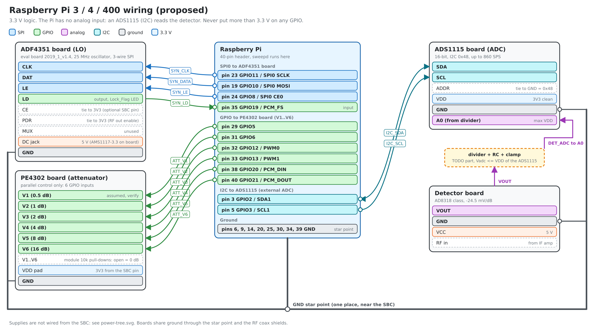
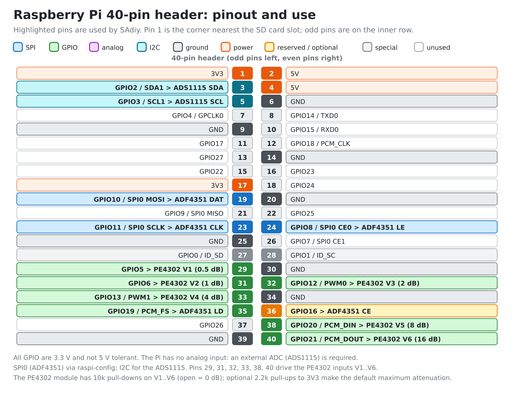

# Wiring: Raspberry Pi 3 / 4 / 400

Diagrams: [wiring](diagrams/rpi-wiring.png) ([svg](diagrams/rpi-wiring.svg)) and [40-pin pinout](diagrams/rpi-gpio-pinout.png) ([svg](diagrams/rpi-gpio-pinout.svg)). Full net list: [netlist.md](netlist.md).





The Pi has no analog input, so the detector is read by an ADS1115 over I2C. GPIO levels are 3.3 V and **not** 5 V tolerant.

## Pins used

| Net | Board pin | Pi pin | BCM GPIO | Notes |
|---|---|---|---|---|
| SYN_CLK | ADF4351 CLK | 23 | GPIO11 SPI0 SCLK | SPI mode 0, MSB first |
| SYN_DATA | ADF4351 DAT | 19 | GPIO10 SPI0 MOSI | 32-bit words |
| SYN_LE | ADF4351 LE | 24 | GPIO8 SPI0 CE0 | hardware chip select, `/dev/spidev0.0` |
| SYN_LD | ADF4351 LD | 35 | GPIO19 | input (Lock_Flag), the MUX pin stays unused |
| SYN_CE (optional) | ADF4351 CE | 36 | GPIO16 | tie the CE header pin to the board's 3V3 pin until needed |
| ATT_V1 | PE4302 V1 (0.5 dB, assumed) | 29 | GPIO5 | |
| ATT_V2 | PE4302 V2 (1 dB) | 31 | GPIO6 | |
| ATT_V3 | PE4302 V3 (2 dB) | 32 | GPIO12 | PWM0 alternate |
| ATT_V4 | PE4302 V4 (4 dB) | 33 | GPIO13 | PWM1 alternate |
| ATT_V5 | PE4302 V5 (8 dB) | 38 | GPIO20 | |
| ATT_V6 | PE4302 V6 (16 dB) | 40 | GPIO21 | |
| I2C_SDA | ADS1115 SDA | 3 | GPIO2 SDA1 | `/dev/i2c-1`, address 0x48 |
| I2C_SCL | ADS1115 SCL | 5 | GPIO3 SCL1 | |
| GND | all boards | 6, 9, 14, 20, 25, 30, 34, 39 | n/a | one star point |

The BCM numbers are also in `config/default.toml` (`attenuator.gpio_rpi_bcm`). The sysfs backend needs the kernel number, which is the BCM number plus the gpiochip base (read it from `/sys/class/gpio/gpiochip*/base`; it is 0 on older kernels and 512 on recent ones). Moving to libgpiod removes that detail.

The SPI0 MISO pin (21) is not used: the ADF4351 has no readback.

## Attenuator control (PE4302 module, parallel only)

The module has no serial interface: a 7-pin header `GND V1 V2 V3 V4 V5 V6` (photo: `photos/pe4302-module.jpg`), six logic inputs, each switching one attenuator stage. The published description of this module gives V1 to V6 = 0.5, 1, 2, 4, 8, 16 dB with high = stage switched in; confirm it with the walk tool. The VDD comes in on two separate pads next to the chip, not on the header.

How the driver behaves (`src/sadiy/drivers/pe4302.py`):
- At start all six lines are driven to "stage in" (31.5 dB), the safe state.
- The six writes are not simultaneous, so stages that turn on are written before stages that turn off. A change from 15.5 dB to 16 dB passes through 31.5 dB, never through 0 dB. All 64 x 64 transitions are tested for this.
- Preview any change: `python tools/bringup.py pe4302-pattern --db 16 --from-db 15.5`.

Hardware you should add:
- **The module has 10 kohm pull-downs on V1 to V6**, so open inputs mean 0 dB attenuation: while the Pi is off or booting the full signal passes (the Pi's own default pulls on these pins are overridden by the module's resistors only if they are weaker). If that matters, add 2.2 kohm pull-ups to 3.3 V on the six lines: with the module's 10 kohm pull-down that gives about 2.7 V at the input, above the 2.3 V threshold, so the default becomes 31.5 dB.
- **Supply:** the module has no regulator and is meant for 3.3 V. Take VDD from the Pi 3V3 pin (pin 1), which is also the GPIO level. A high input needs 0.7 x VDD, so with a 5 V supply the 3.3 V GPIO would not reach it. Measure the voltage on the supply pads before connecting anything: the leads go toward the shared lever connector in the photos.

**Identify V1 to V6 with the walk tool** (run it on the Pi with a low-level tone through the attenuator into the detector and a DMM on the detector output):

```
python tools/bringup.py pe4302-walk --gpio <kernel numbers of GPIO5,6,12,13,20,21>
```

It switches one stage in at a time. The detector output should RISE by weight x 24.5 mV (V6 about 392 mV, V1 about 12 mV). Keep the RF level below -20 dBm. Write the measured weights into `attenuator.weights_db` and set `attenuator.active_high`. `--dry-run` prints the procedure without touching GPIO.

## Before you connect anything

1. Enable SPI0 and I2C (`raspi-config`, interface options). Check `ls /dev/spidev0.0 /dev/i2c-1`.
2. Check the ADS1115 appears at 0x48 with `i2cdetect -y 1` once it is wired.
3. The ADF4351 board takes 5 V on its DC jack (check the polarity marking) and regulates to 3.3 V itself: do not feed its `3V3` header pin. The PE4302 VDD pad and the ADS1115 can take 3.3 V from the Pi 3V3 pin (pin 1 or 17): tiny currents.

## Wiring order

1. Power the Pi alone and check pin 1 (3V3) and pin 2 (5V) with a DMM.
2. **Ground first**: Pi GND to the star point, then each board's GND.
3. PE4302 board: measure the voltage on its supply pads first, then VDD pad to pin 1 (3V3) and `GND` to the star point, then the six lines to pins 29, 31, 32, 33, 38, 40 (optional 2.2 kohm pull-ups on the six lines). Run the walk tool above and note the weights and polarity before connecting any RF.
4. ADF4351 board: 5 V on the DC jack, `CE` and `PDR` to the board's `3V3` pin (unless the board already pulls them up), then `CLK`, `DAT`, `LE` (pins 23, 19, 24), `LD` (pin 35) and `GND`. Capture the SPI lines with the DSLogic (`python tools/bringup.py adf4351-pattern --word 0x...`).
5. ADS1115: VDD 3.3 V, GND, ADDR to GND, then SDA and SCL (pins 3 and 5). Check `i2cdetect`.
6. Detector: VCC 5 V, GND, VOUT through the divider/RC/clamp block to A0. Check the A0 voltage with a DMM before connecting it.

## Analog input (ADS1115)

- 16-bit, up to 860 samples per second. With VDD 3.3 V use the +/-2.048 V full-scale range: one LSB is 62.5 uV, about 0.0025 dB at the detector slope. The detector output is about 0.5 V at -1 dBm and about 1.9 V near -58 dBm, so **no divider is needed** (set `detector.divider_ratio = 1.0`).
- The input must never exceed VDD + 0.3 V. Add an RC low-pass and a clamp (Schottky diodes to the ADS1115 supply and ground) in the divider/RC/clamp block.
- 860 samples per second is the sweep-rate limit: about 1 ms per point with one sample. Plan for fewer points or an external SPI ADC later (`docs/architecture.md`).

## Power-on checks (DMM)

| Check | Expect |
|---|---|
| 3.3 V at the PE4302 VDD pad and the ADS1115, and at the ADF4351 board `3V3` pin | 3.0 to 3.6 V |
| 10 V rail at the AD831 module | 9 to 11 V |
| 5 V at the detector | 4.75 to 5.5 V |
| V1 to V6 with the Pi not driving them | low (module pull-downs) = 0 dB, or high if you fitted pull-ups |
| A0 with the detector powered and no RF | below the ADS1115 VDD |

Then follow `docs/bringup.md`.
